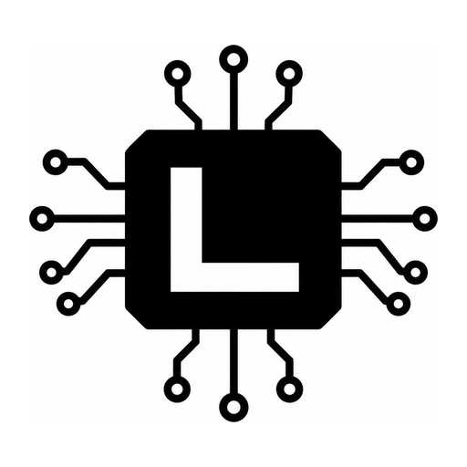

<p align="center">
  
</p>

<h1 align="center">LogicSM</h1>

<p align="center">
  Diseña, visualiza y simula circuitos digitales escribiendo código.
</p>

<p align="center">
  <a href="https://github.com/VstevenMata/New-Logic-IDE/releases/latest"></a>
  <a href="#licencia"></a>
</p>

---

LogicSM es un entorno de escritorio para aprender electrónica digital. En vez de dibujar cables, el circuito se escribe en un lenguaje sencillo, y la app lo dibuja y lo simula automáticamente.

```cpp
X = xor.set(2);
Y = and.set(2);

circuit HalfAdder {
    in A, B;
    out Suma, Acarreo;

    Suma    = X(A, B);
    Acarreo = Y(A, B);
}
```

## Qué permite

- **Escribir circuitos en código** y verlos dibujados al instante.
- **Simular en tiempo real** con interruptores, pulsadores, reloj y paso a paso.
- **Crear componentes propios** y reutilizarlos: de compuertas a sumadores, ALU y una CPU educativa.
- **Aprender con ayudas exactas:** errores con sugerencia, tabla de verdad y verificación de resultados.
- **Exportar** a Verilog y a LogicCircuit.

## Instalación

**Linux y macOS**

```bash
curl -fsSL https://raw.githubusercontent.com/VstevenMata/New-Logic-IDE/main/instalar.sh | bash
```

**Windows** (PowerShell)

```powershell
irm https://raw.githubusercontent.com/VstevenMata/New-Logic-IDE/main/instalar.ps1 | iex
```

**NixOS**

```bash
nix run github:VstevenMata/New-Logic-IDE
```

Después se abre con `logicsm` y se actualiza con `logicsm update`.

## Estado

En desarrollo. La interfaz ya está lista; el lenguaje y el simulador se están construyendo.

| | Etapa |
|---|---|
| ✅ | Interfaz de escritorio con tema claro y oscuro |
| ✅ | Instaladores y actualización automática |
| ✅ | Publicación automática de versiones para Linux, macOS y Windows |
| ✅ | Revisión automática de cada cambio (CI) |
| 🔨 | Lenguaje: lexer, parser y análisis semántico |
| ⏳ | Simulador por eventos y dibujo automático del circuito |
| ⏳ | Circuitos secuenciales, buses, display de 7 segmentos y ondas |
| ⏳ | Herramientas educativas y exportación a Verilog y LogicCircuit |

## Documentación

- [Diseño del lenguaje y la arquitectura](docs/DISENO.md)
- [Guía para desarrolladores](COMANDOS.md)

## Licencia

Doble licencia, a elección: [MIT](LICENSE-MIT) o [Apache-2.0](LICENSE-APACHE).
